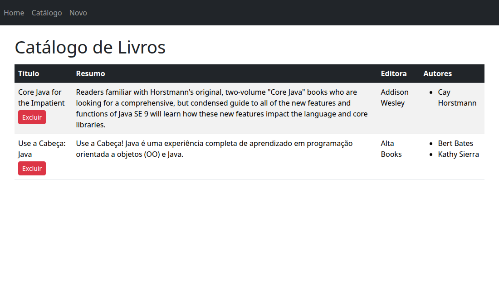
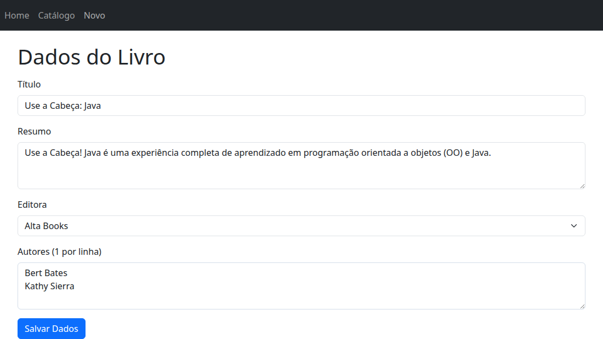
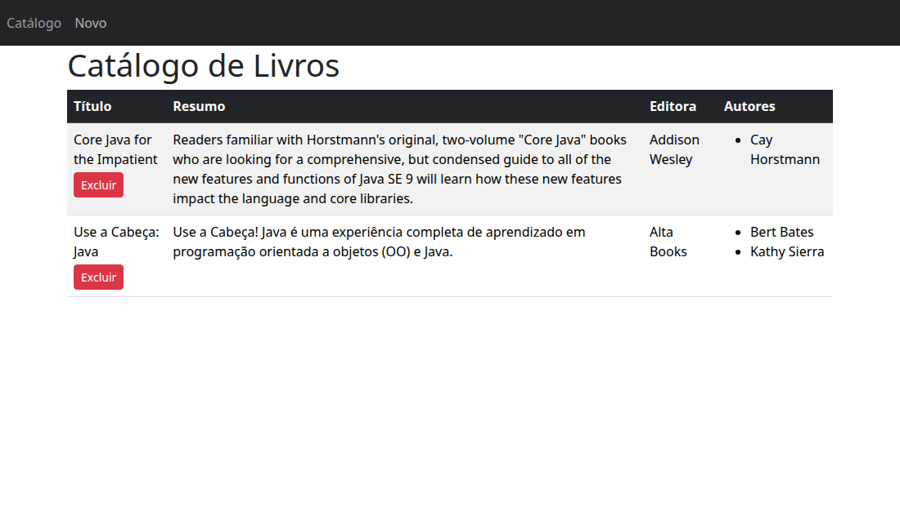
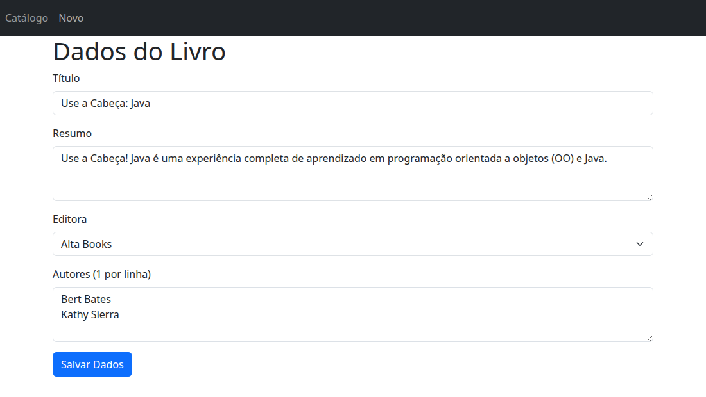

# DGT2815 - Integração de Páginas Web com Banco de Dados

Aluno: Jailton de Oliveira Nobrega

Trabalho prático: servidor com Express e Mongoose acessando o MongoDB, e os
front-ends em React, Next e Angular alterados para usar esse servidor.

## Estrutura

```
livro-servidor/        servidor Express + Mongoose (porta 3030)
clientes/
  livros-react/        React (porta 3000)
  livros-next/         Next (porta 3000)
  livros-angular/      Angular (porta 4200)
prints/                telas funcionando
```

## Banco de dados

Banco `livraria`, coleção `livros`, criados pelo MongoDB Compass.
A conexão fica em `livro-servidor/modelo/conexao.js`
(`mongodb://127.0.0.1:27017/livraria`).

## Como rodar

Servidor:

```
cd livro-servidor
npm install
npm start
```

Rotas:

| Método | Rota            | O que faz         |
|--------|-----------------|-------------------|
| GET    | /livros         | lista os livros   |
| POST   | /livros         | inclui um livro   |
| DELETE | /livros/:codigo | exclui pelo `_id` |

Exemplo de corpo do POST:

```json
{
  "_id": null,
  "codEditora": 1,
  "titulo": "Use a Cabeça: Java",
  "resumo": "Use a Cabeça! Java é uma experiência completa de aprendizado em programação orientada a objetos (OO) e Java.",
  "autores": ["Bert Bates", "Kathy Sierra"]
}
```

Clientes (com o servidor rodando):

```
cd clientes/livros-react
npm install
npm start          # http://localhost:3000

cd clientes/livros-next
npm install
npm run dev        # http://localhost:3000

cd clientes/livros-angular
npm install
ng serve           # http://localhost:4200
```

React e Next usam a mesma porta, então um de cada vez.

## Observações

- O servidor usa o mongoose 8. Na versão 9 as opções `useUnifiedTopology` e
  `useNewUrlParser` pedidas no roteiro dão erro na conexão.
- Como o `_id` é declarado no schema, coloquei `auto: true` para o ObjectId
  ser gerado quando o livro chega com `_id` nulo. Sem isso o livro era gravado
  com `_id: null` e o segundo cadastro dava chave duplicada.

## Telas

React


Next




Angular



